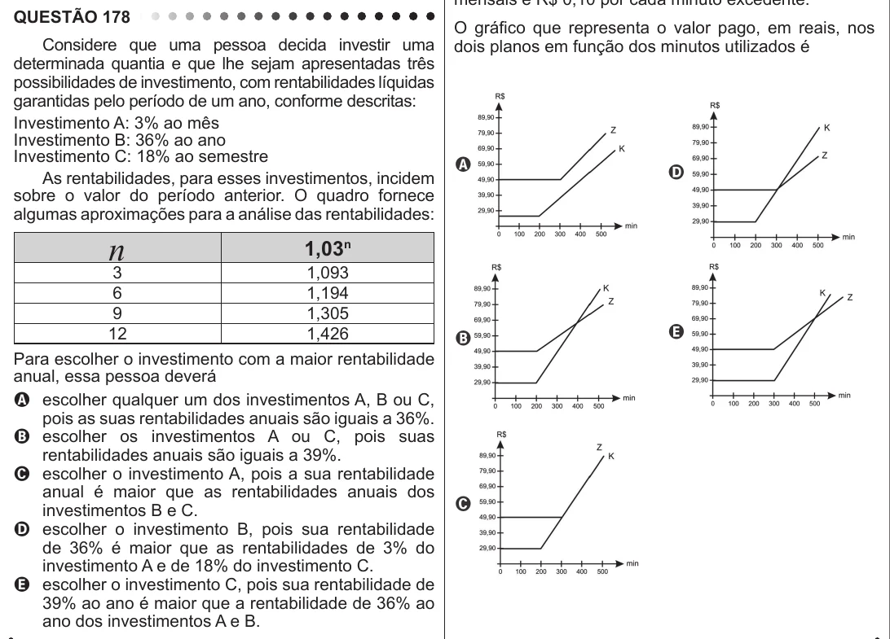

Texto extraído (pode conter ruído)

QUESTÃO 178  
O gráfico que representa o valor pago, em reais, nos  
Considere que uma pessoa decida investir uma  
dois planos em função dos minutos utilizados é  
determinada quantia e que lhe sejam apresentadas três  
possibilidades de investimento, com rentabilidades líquidas  
garantidas pelo período de um ano, conforme descritas:  
Investimento A: 3% ao mês  
Investimento B: 36% ao ano  
Investimento C: 18% ao semestre  
As rentabilidades, para esses investimentos, incidem  
sobre o valor do período anterior. O quadro fornece  
algumas aproximações para a análise das rentabilidades:  
n  
1,03 n  
3  
1,093  
6  
1,194  
9  
1,305  
12  
1,426  
Para escolher o investimento com a maior rentabilidade  
anual, essa pessoa deverá  
A escolher qualquer um dos investimentos A, B ou C,  
pois as suas rentabilidades anuais são iguais a 36%.  
B escolher os investimentos A ou C, pois suas  
rentabilidades anuais são iguais a 39%.  
C escolher o investimento A, pois a sua rentabilidade  
anual é maior que as rentabilidades anuais dos  
investimentos B e C.  
D escolher o investimento B, pois sua rentabilidade  
de 36% é maior que as rentabilidades de 3% do  
investimento A e de 18% do investimento C.  
E escolher o investimento C, pois sua rentabilidade de  
39% ao ano é maior que a rentabilidade de 36% ao  
ano dos investimentos A e B.

