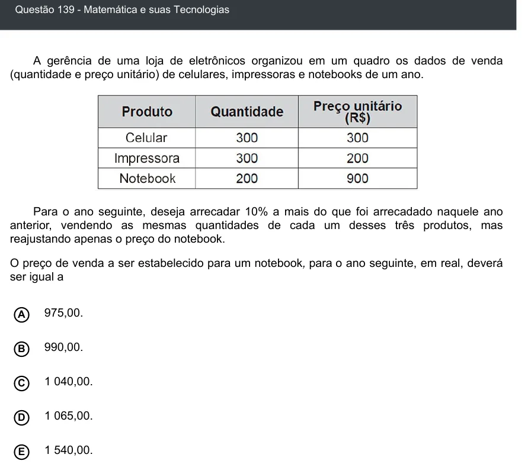

Texto extraído (pode conter ruído)

Questão 139 - Matemática e suas Tecnologias  
A gerência de uma loja de eletrônicos organizou em um quadro os dados de venda  
(quantidade e preço unitário) de celulares, impressoras e notebooks de um ano.  
Para o ano seguinte, deseja arrecadar 10% a mais do que foi arrecadado naquele ano  
anterior, vendendo as mesmas quantidades de cada um desses três produtos, mas  
reajustando apenas o preço do notebook.  
O preço de venda a ser estabelecido para um notebook, para o ano seguinte, em real, deverá  
ser igual a  
975,00.  
A  
990,00.  
B  
1 040,00.  
C  
D  
1 065,00.  
1 540,00.  
E

