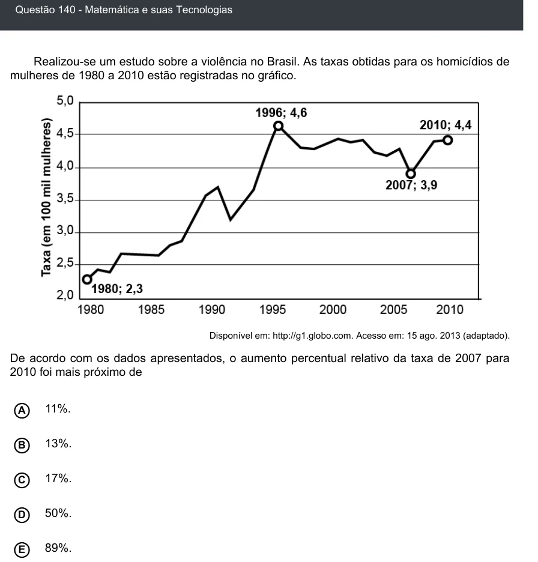

Texto extraído (pode conter ruído)

Questão 140 - Matemática e suas Tecnologias  
Realizou-se um estudo sobre a violência no Brasil. As taxas obtidas para os homicídios de  
mulheres de 1980 a 2010 estão registradas no gráfico.  
Disponível em: http://g1.globo.com. Acesso em: 15 ago. 2013 (adaptado).  
De acordo com os dados apresentados, o aumento percentual relativo da taxa de 2007 para  
2010 foi mais próximo de  
11%.  
A  
B  
13%.  
C  
17%.  
50%.  
D  
89%.  
E

