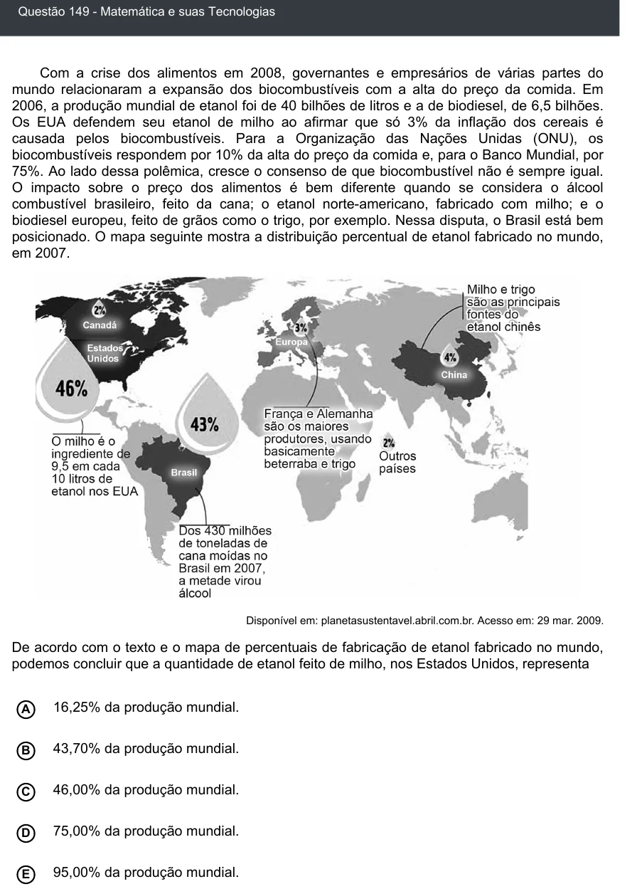

Texto extraído (pode conter ruído)

Questão 149 - Matemática e suas Tecnologias  
Com a crise dos alimentos em 2008, governantes e empresários de várias partes do  
mundo relacionaram a expansão dos biocombustíveis com a alta do preço da comida. Em  
2006, a produção mundial de etanol foi de 40 bilhões de litros e a de biodiesel, de 6,5 bilhões.  
Os EUA defendem seu etanol de milho ao afirmar que só 3% da inflação dos cereais é  
causada pelos biocombustíveis. Para a Organização das Nações Unidas (ONU), os  
biocombustíveis respondem por 10% da alta do preço da comida e, para o Banco Mundial, por  
75%. Ao lado dessa polêmica, cresce o consenso de que biocombustível não é sempre igual.  
O impacto sobre o preço dos alimentos é bem diferente quando se considera o álcool  
combustível brasileiro, feito da cana; o etanol norte-americano, fabricado com milho; e o  
biodiesel europeu, feito de grãos como o trigo, por exemplo. Nessa disputa, o Brasil está bem  
posicionado. O mapa seguinte mostra a distribuição percentual de etanol fabricado no mundo,  
em 2007.  
Disponível em: planetasustentavel.abril.com.br. Acesso em: 29 mar. 2009.  
De acordo com o texto e o mapa de percentuais de fabricação de etanol fabricado no mundo,  
podemos concluir que a quantidade de etanol feito de milho, nos Estados Unidos, representa  
16,25% da produção mundial.  
A  
B  
43,70% da produção mundial.  
46,00% da produção mundial.  
C  
75,00% da produção mundial.  
D  
95,00% da produção mundial.  
E

