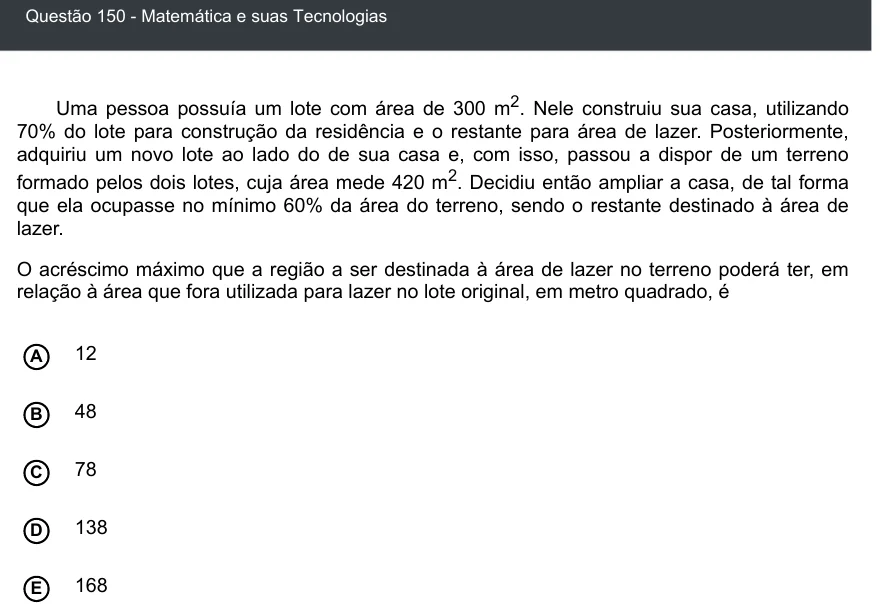

Texto extraído (pode conter ruído)

Questão 150 - Matemática e suas Tecnologias  
Uma pessoa possuía um lote com área de 300 m 2 . Nele construiu sua casa, utilizando  
70% do lote para construção da residência e o restante para área de lazer. Posteriormente,  
adquiriu um novo lote ao lado do de sua casa e, com isso, passou a dispor de um terreno  
formado pelos dois lotes, cuja área mede 420 m 2 . Decidiu então ampliar a casa, de tal forma  
que ela ocupasse no mínimo 60% da área do terreno, sendo o restante destinado à área de  
lazer.  
O acréscimo máximo que a região a ser destinada à área de lazer no terreno poderá ter, em  
relação à área que fora utilizada para lazer no lote original, em metro quadrado, é  
12  
A  
48  
B  
78  
C  
D  
138  
168  
E

