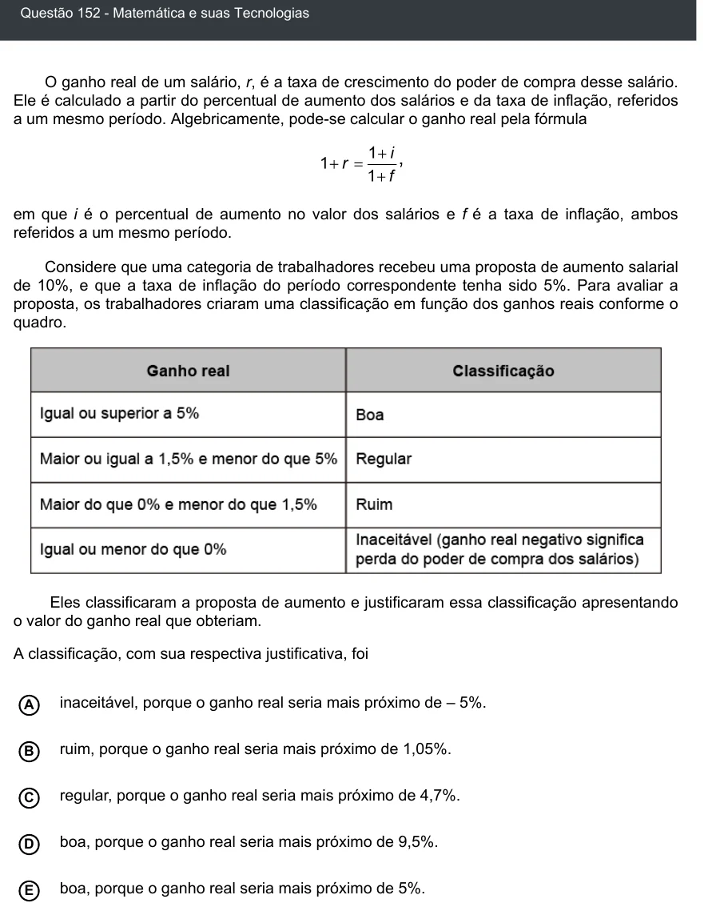

Texto extraído (pode conter ruído)

Questão 152 - Matemática e suas Tecnologias  
O ganho real de um salário, r, é a taxa de crescimento do poder de compra desse salário.  
Ele é calculado a partir do percentual de aumento dos salários e da taxa de inflação, referidos  
a um mesmo período. Algebricamente, pode-se calcular o ganho real pela fórmula  
em que i é o percentual de aumento no valor dos salários e f é a taxa de inflação, ambos  
referidos a um mesmo período.  
Considere que uma categoria de trabalhadores recebeu uma proposta de aumento salarial  
de 10%, e que a taxa de inflação do período correspondente tenha sido 5%. Para avaliar a  
proposta, os trabalhadores criaram uma classificação em função dos ganhos reais conforme o  
quadro.  
Eles classificaram a proposta de aumento e justificaram essa classificação apresentando  
o valor do ganho real que obteriam.  
A classificação, com sua respectiva justificativa, foi  
A  
inaceitável, porque o ganho real seria mais próximo de – 5%.  
ruim, porque o ganho real seria mais próximo de 1,05%.  
B  
regular, porque o ganho real seria mais próximo de 4,7%.  
C  
D  
boa, porque o ganho real seria mais próximo de 9,5%.  
boa, porque o ganho real seria mais próximo de 5%.  
E

