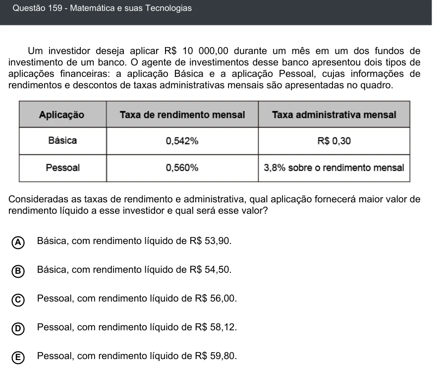

Texto extraído (pode conter ruído)

Questão 159 - Matemática e suas Tecnologias  
Um investidor deseja aplicar R$ 10 000,00 durante um mês em um dos fundos de  
investimento de um banco. O agente de investimentos desse banco apresentou dois tipos de  
aplicações financeiras: a aplicação Básica e a aplicação Pessoal, cujas informações de  
rendimentos e descontos de taxas administrativas mensais são apresentadas no quadro.  
Consideradas as taxas de rendimento e administrativa, qual aplicação fornecerá maior valor de  
rendimento líquido a esse investidor e qual será esse valor?  
Básica, com rendimento líquido de R$ 53,90.  
A  
Básica, com rendimento líquido de R$ 54,50.  
B  
C  
Pessoal, com rendimento líquido de R$ 56,00.  
Pessoal, com rendimento líquido de R$ 58,12.  
D  
Pessoal, com rendimento líquido de R$ 59,80.  
E

