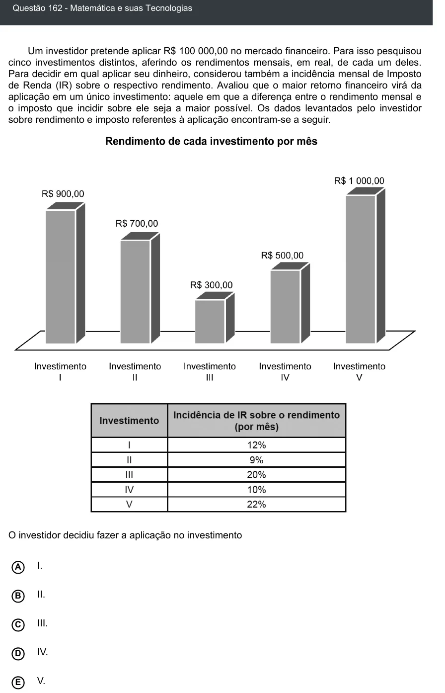

Texto extraído (pode conter ruído)

Questão 162 - Matemática e suas Tecnologias  
Um investidor pretende aplicar R$ 100 000,00 no mercado financeiro. Para isso pesquisou  
cinco investimentos distintos, aferindo os rendimentos mensais, em real, de cada um deles.  
Para decidir em qual aplicar seu dinheiro, considerou também a incidência mensal de Imposto  
de Renda (IR) sobre o respectivo rendimento. Avaliou que o maior retorno financeiro virá da  
aplicação em um único investimento: aquele em que a diferença entre o rendimento mensal e  
o imposto que incidir sobre ele seja a maior possível. Os dados levantados pelo investidor  
sobre rendimento e imposto referentes à aplicação encontram-se a seguir.  
O investidor decidiu fazer a aplicação no investimento  
I.  
A  
B  
II.  
III.  
C  
IV.  
D  
E  
V.

