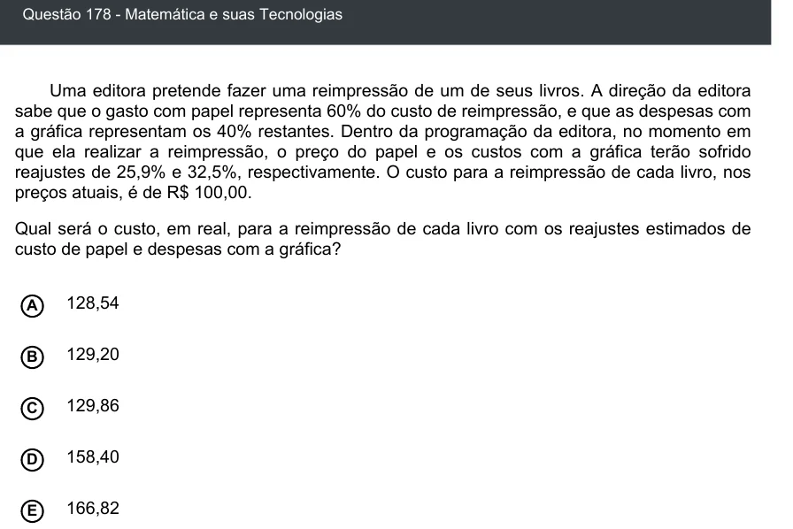

Texto extraído (pode conter ruído)

Questão 178 - Matemática e suas Tecnologias  
Uma editora pretende fazer uma reimpressão de um de seus livros. A direção da editora  
sabe que o gasto com papel representa 60% do custo de reimpressão, e que as despesas com  
a gráfica representam os 40% restantes. Dentro da programação da editora, no momento em  
que ela realizar a reimpressão, o preço do papel e os custos com a gráfica terão sofrido  
reajustes de 25,9% e 32,5%, respectivamente. O custo para a reimpressão de cada livro, nos  
preços atuais, é de R$ 100,00.  
Qual será o custo, em real, para a reimpressão de cada livro com os reajustes estimados de  
custo de papel e despesas com a gráfica?  
128,54  
A  
129,20  
B  
C  
129,86  
158,40  
D  
166,82  
E

