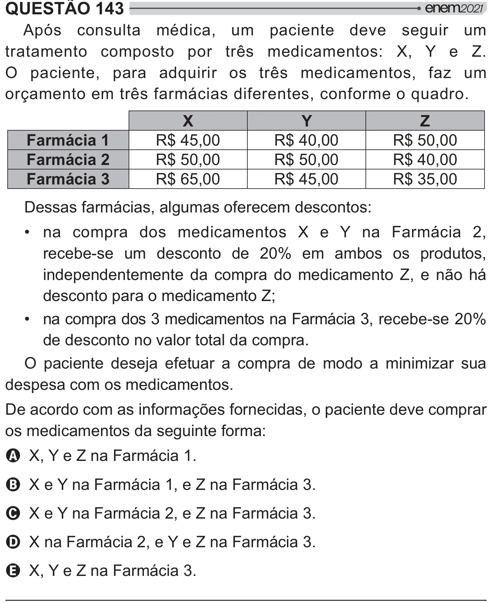

Texto extraído (pode conter ruído)

QUESTÃO 143  
Após consulta médica, um paciente deve seguir um  
tratamento composto por três medicamentos: X, Y e Z.  
O paciente, para adquirir os três medicamentos, faz um  
orçamento em três farmácias diferentes, conforme o quadro.  
X  
Y  
Z  
Farmácia 1  
R$ 45,00  
R$ 40,00  
R$ 50,00  
Farmácia 2  
R$ 50,00  
R$ 50,00  
R$ 40,00  
Farmácia 3  
R$ 65,00  
R$ 45,00  
R$ 35,00  
Dessas farmácias, algumas oferecem descontos:  
• na compra dos medicamentos X e Y na Farmácia 2,  
recebe-se um desconto de 20% em ambos os produtos,  
independentemente da compra do medicamento Z, e não há  
desconto para o medicamento Z;  
• na compra dos 3 medicamentos na Farmácia 3, recebe-se 20%  
de desconto no valor total da compra.  
O paciente deseja efetuar a compra de modo a minimizar sua  
despesa com os medicamentos.  
De acordo com as informações fornecidas, o paciente deve comprar  
os medicamentos da seguinte forma:  
A X, Y e Z na Farmácia 1.  
B X e Y na Farmácia 1, e Z na Farmácia 3.  
C X e Y na Farmácia 2, e Z na Farmácia 3.  
D X na Farmácia 2, e Y e Z na Farmácia 3.  
E X, Y e Z na Farmácia 3.

