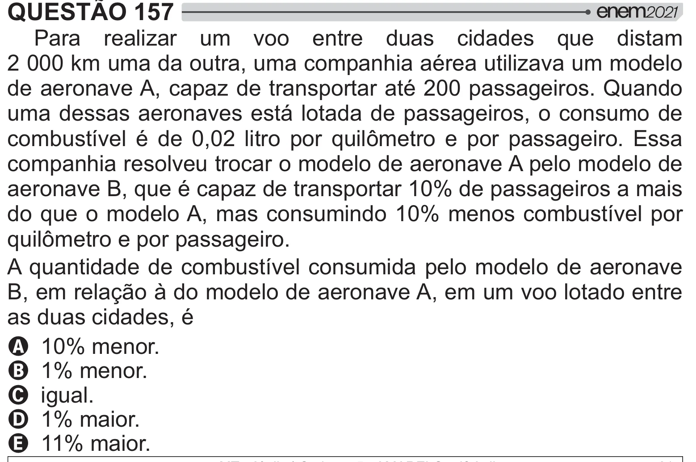

Texto extraído (pode conter ruído)

QUESTÃO 157  
Para realizar um voo entre duas cidades que distam  
2 000 km uma da outra, uma companhia aérea utilizava um modelo  
de aeronave A, capaz de transportar até 200 passageiros. Quando  
uma dessas aeronaves está lotada de passageiros, o consumo de  
y {"  <   __‘   # 2   # #  !    
companhia resolveu trocar o modelo de aeronave A pelo modelo de  
aeronave B, que é capaz de transportar 10% de passageiros a mais  
do que o modelo A, mas consumindo 10% menos combustível por  
2  ##  !  
A quantidade de combustível consumida pelo modelo de aeronave  
B, em relação à do modelo de aeronave A, em um voo lotado entre  
as duas cidades, é  
A 10% menor.  
B 1% menor.  
C igual.  
D 1% maior.  
E 11% maior.

