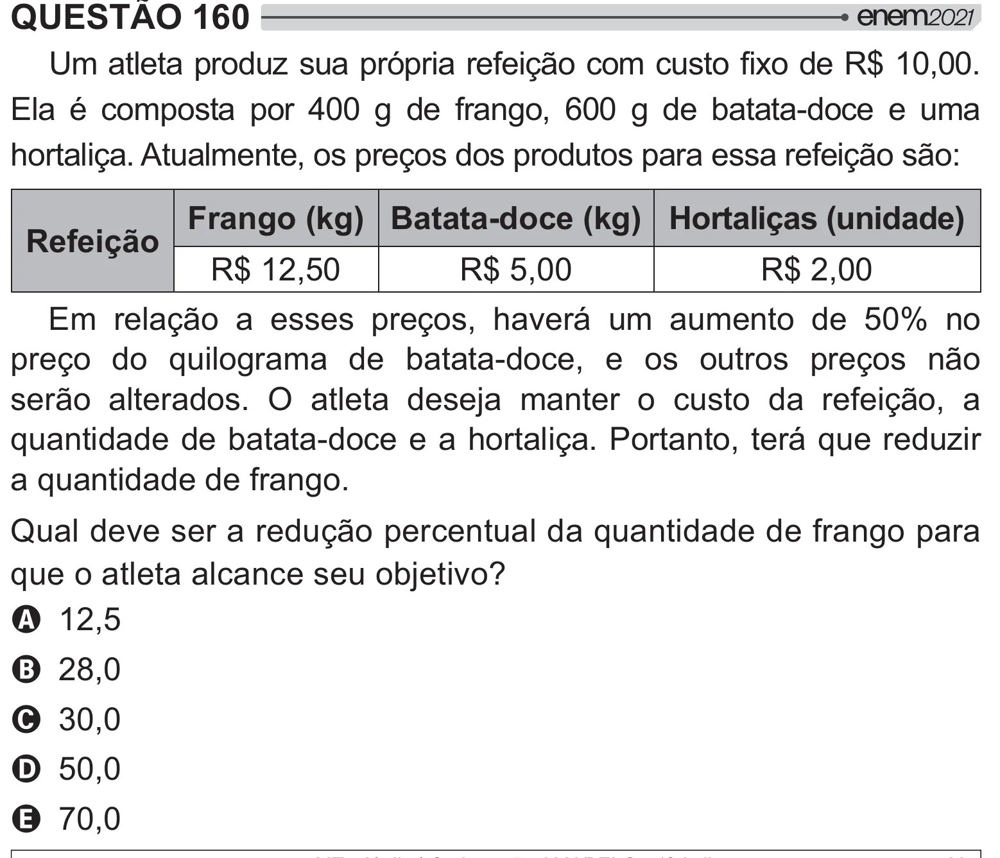

Texto extraído (pode conter ruído)

QUESTÃO 160  
'  #  #ƒ# > =[ * ½`___!  
Ela é composta por 400 g de frango, 600 g de batata-doce e uma  
hortaliça. Atualmente, os preços dos produtos para essa refeição são:  
Frango (kg) Batata-doce (kg) Hortaliças (unidade)  
Refeição  
R$ 12,50  
R$ 5,00  
R$ 2,00  
Em relação a esses preços, haverá um aumento de 50% no  
preço do quilograma de batata-doce, e os outros preços não  
serão alterados. O atleta deseja manter o custo da refeição, a  
quantidade de batata-doce e a hortaliça. Portanto, terá que reduzir  
a quantidade de frango.  
Qual deve ser a redução percentual da quantidade de frango para  
que o atleta alcance seu objetivo?  
A 12,5  
B 28,0  
C 30,0  
D 50,0  
E 70,0

