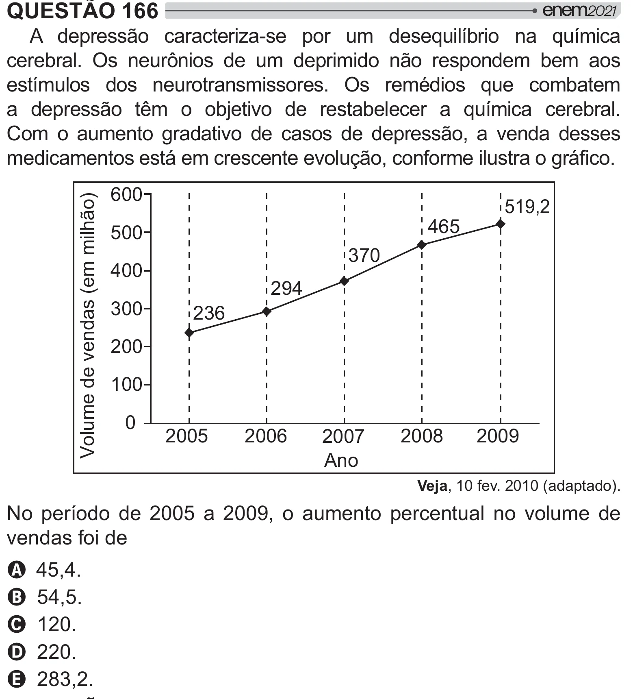

Texto extraído (pode conter ruído)

QUESTÃO 166  
A depressão caracteriza-se por um desequilíbrio na química  
  y!    2      # [  #  y     
estímulos dos neurotransmissores. Os remédios que combatem  
a depressão têm o objetivo de restabelecer a química cerebral.  
Com o aumento gradativo de casos de depressão, a venda desses  
     /     " =[>  /!  
600  
Volume de vendas (em milhão)  
519,2  
465  
500  
370  
400  
294  
300  
236  
200  
100  
0  
2005  
2006  
2008  
2009  
2007  
Ano  
Veja, 10 fev. 2010 (adaptado).  
No período de 2005 a 2009, o aumento percentual no volume de  
vendas foi de  
A 45,4.  
B 54,5.  
C 120.  
D 220.  
E 283,2.

