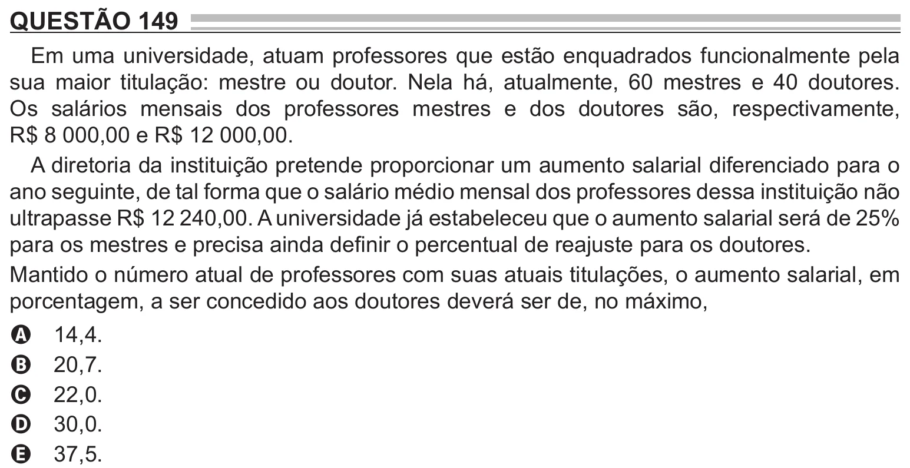

Texto extraído (pode conter ruído)

QUESTÃO 149  
Em uma universidade, atuam professores que estão enquadrados funcionalmente pela  
sua maior titulação: mestre ou doutor. Nela há, atualmente, 60 mestres e 40 doutores.  
Os salários mensais dos professores mestres e dos doutores são, respectivamente,  
R$ 8 000,00 e R$ 12 000,00.  
A diretoria da instituição pretende proporcionar um aumento salarial diferenciado para o  
ano seguinte, de tal forma que o salário médio mensal dos professores dessa instituição não  
ultrapasse R$ 12 240,00. A universidade já estabeleceu que o aumento salarial será de 25%  
para os mestres e precisa ainda definir o percentual de reajuste para os doutores.  
Mantido o número atual de professores com suas atuais titulações, o aumento salarial, em  
porcentagem, a ser concedido aos doutores deverá ser de, no máximo,  
14,4.  
A  
20,7.  
B  
22,0.  
C  
30,0.  
D  
37,5.  
E

