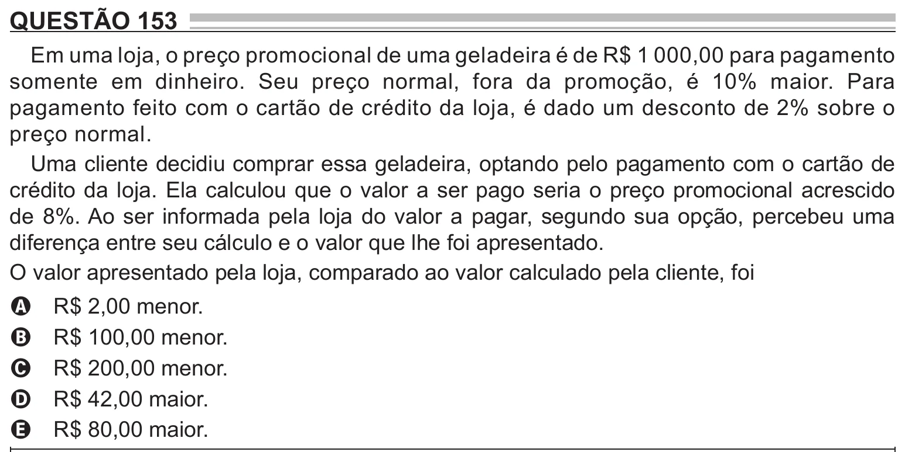

Texto extraído (pode conter ruído)

QUESTÃO 153  
Em uma loja, o preço promocional de uma geladeira é de R$ 1 000,00 para pagamento  
somente em dinheiro. Seu preço normal, fora da promoção, é 10% maior. Para  
pagamento feito com o cartão de crédito da loja, é dado um desconto de 2% sobre o  
preço normal.  
Uma cliente decidiu comprar essa geladeira, optando pelo pagamento com o cartão de  
crédito da loja. Ela calculou que o valor a ser pago seria o preço promocional acrescido  
de 8%. Ao ser informada pela loja do valor a pagar, segundo sua opção, percebeu uma  
diferença entre seu cálculo e o valor que lhe foi apresentado.  
O valor apresentado pela loja, comparado ao valor calculado pela cliente, foi  
R$ 2,00 menor.  
A  
R$ 100,00 menor.  
B  
R$ 200,00 menor.  
C  
R$ 42,00 maior.  
D  
R$ 80,00 maior.  
E

