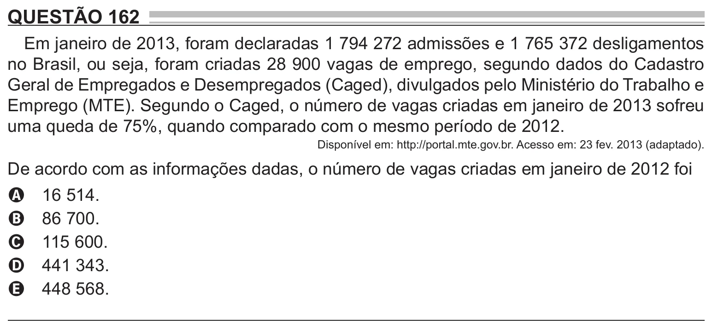

Texto extraído (pode conter ruído)

QUESTÃO 162  
Em janeiro de 2013, foram declaradas 1 794 272 admissões e 1 765 372 desligamentos  
no Brasil, ou seja, foram criadas 28 900 vagas de emprego, segundo dados do Cadastro  
Geral de Empregados e Desempregados (Caged), divulgados pelo Ministério do Trabalho e  
Emprego (MTE). Segundo o Caged, o número de vagas criadas em janeiro de 2013 sofreu  
uma queda de 75%, quando comparado com o mesmo período de 2012.  
Disponível em: http://portal.mte.gov.br. Acesso em: 23 fev. 2013 (adaptado).  
De acordo com as informações dadas, o número de vagas criadas em janeiro de 2012 foi  
16 514.  
A  
86 700.  
B  
115 600.  
C  
441 343.  
D  
448 568.  
E

