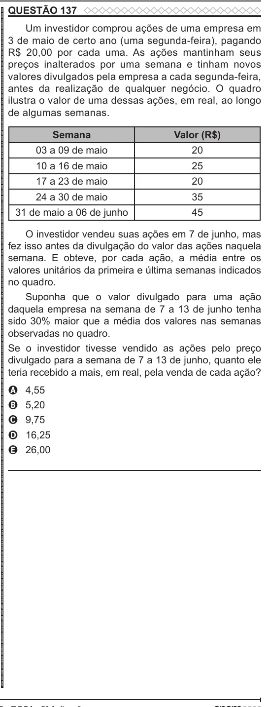

Texto extraído (pode conter ruído)

QUESTÃO 137  
ENEM 2022 ENEM 2022 ENEM 2022 ENEM 2022 ENEM 2022 ENEM 2022 ENEM 2022 ENEM 2022 ENEM 2022 ENEM 2022 ENEM 2022 ENEM 2022 ENEM 2022 ENEM 2022 ENEM 2022 ENEM 2022 ENEM 2022 ENEM 2022 ENEM 2022 ENEM 2022 ENEM 2022 ENEM 2022 ENEM 2022 ENEM 2022 ENEM 2022 ENEM 2022 ENEM 2022 ENEM 2022 ENEM 2022 ENEM 2022 ENEM 2022 ENEM 2022 ENEM 2022 ENEM 2022 ENEM 2022 ENEM 2022 ENEM 2022 ENEM 2022 ENEM 2022 ENEM 2022 ENEM 2022 ENEM 2022 ENEM 2022 ENEM 2022 ENEM 2022 ENEM 2022 ENEM 2022 ENEM 2022 ENEM 2022 ENEM 2022 ENEM 2022 ENEM 2022 ENEM 2022 ENEM 2022 ENEM 2022 ENEM 2022 ENEM 2022 ENEM 2022 ENEM 2022 ENEM 2022 ENEM 2022 ENEM 2022 ENEM 2022  
Um investidor comprou ações de uma empresa em  
3 de maio de certo ano (uma segunda-feira), pagando  
R$ 20,00 por cada uma. As ações mantinham seus  
preços inalterados por uma semana e tinham novos  
valores divulgados pela empresa a cada segunda-feira,  
antes da realização de qualquer negócio. O quadro  
ilustra o valor de uma dessas ações, em real, ao longo  
de algumas semanas.  
Semana  
Valor (R$)  
03 a 09 de maio  
20  
10 a 16 de maio  
25  
17 a 23 de maio  
20  
24 a 30 de maio  
35  
31 de maio a 06 de junho  
45  
O investidor vendeu suas ações em 7 de junho, mas  
fez isso antes da divulgação do valor das ações naquela  
semana. E obteve, por cada ação, a média entre os  
valores unitários da primeira e última semanas indicados  
no quadro.  
Suponha que o valor divulgado para uma ação  
daquela empresa na semana de 7 a 13 de junho tenha  
sido 30% maior que a média dos valores nas semanas  
observadas no quadro.  
Se o investidor tivesse vendido as ações pelo preço  
divulgado para a semana de 7 a 13 de junho, quanto ele  
teria recebido a mais, em real, pela venda de cada ação?  
A  
4,55  
5,20  
B  
9,75  
C  
16,25  
D  
26,00  
E

