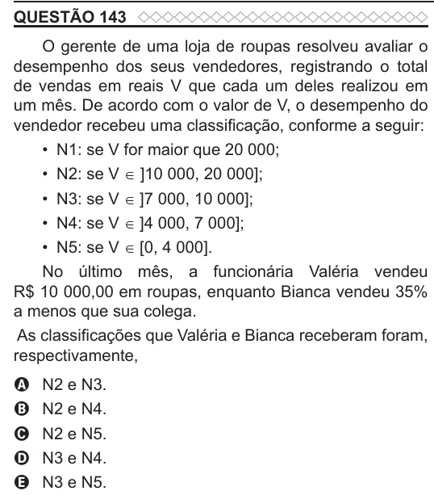

Texto extraído (pode conter ruído)

QUESTÃO 143  
O gerente de uma loja de roupas resolveu avaliar o  
desempenho dos seus vendedores, registrando o total  
de vendas em reais V que cada um deles realizou em  
um mês. De acordo com o valor de V, o desempenho do  
vendedor recebeu uma classificação, conforme a seguir:  
• N1: se V for maior que 20 000;  
• N2: se V ∈ ]10 000, 20 000];  
• N3: se V ∈ ]7 000, 10 000];  
• N4: se V ∈ ]4 000, 7 000];  
• N5: se V ∈ [0, 4 000].  
No último mês, a funcionária Valéria vendeu  
R$ 10 000,00 em roupas, enquanto Bianca vendeu 35%  
a menos que sua colega.  
As classificações que Valéria e Bianca receberam foram,  
respectivamente,  
N2 e N3.  
A  
N2 e N4.  
B  
N2 e N5.  
C  
N3 e N4.  
D  
N3 e N5.  
E

