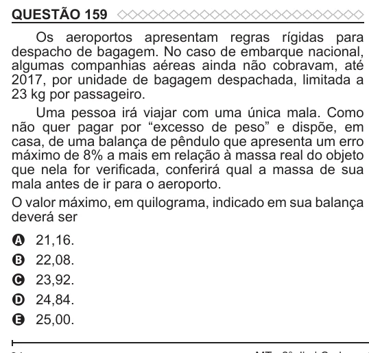

Texto extraído (pode conter ruído)

QUESTÃO 159  
Os aeroportos apresentam regras rígidas para  
despacho de bagagem. No caso de embarque nacional,  
algumas companhias aéreas ainda não cobravam, até  
2017, por unidade de bagagem despachada, limitada a  
23 kg por passageiro.  
Uma pessoa irá viajar com uma única mala. Como  
não quer pagar por “excesso de peso” e dispõe, em  
casa, de uma balança de pêndulo que apresenta um erro  
máximo de 8% a mais em relação à massa real do objeto  
que nela for verificada, conferirá qual a massa de sua  
mala antes de ir para o aeroporto.  
O valor máximo, em quilograma, indicado em sua balança  
deverá ser  
21,16.  
A  
B  
22,08.  
23,92.  
C  
24,84.  
D  
E  
25,00.

