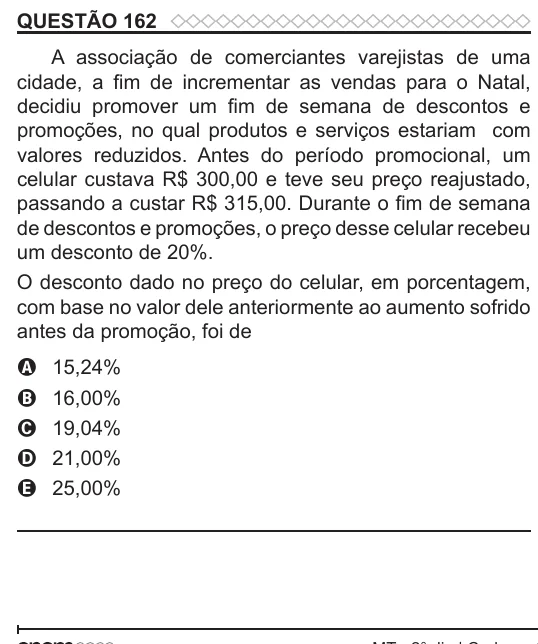

Texto extraído (pode conter ruído)

QUESTÃO 162  
A associação de comerciantes varejistas de uma  
cidade, a fim de incrementar as vendas para o Natal,  
decidiu promover um fim de semana de descontos e  
promoções, no qual produtos e serviços estariam com  
valores reduzidos. Antes do período promocional, um  
celular custava R$ 300,00 e teve seu preço reajustado,  
passando a custar R$ 315,00. Durante o fim de semana  
de descontos e promoções, o preço desse celular recebeu  
um desconto de 20%.  
O desconto dado no preço do celular, em porcentagem,  
com base no valor dele anteriormente ao aumento sofrido  
antes da promoção, foi de  
15,24%  
A  
16,00%  
B  
19,04%  
C  
21,00%  
D  
E  
25,00%

