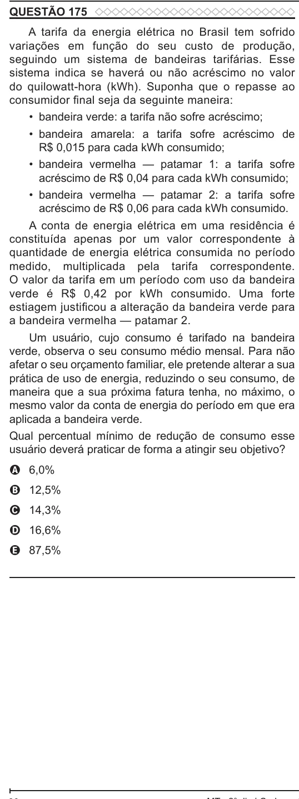

Texto extraído (pode conter ruído)

QUESTÃO 175  
A tarifa da energia elétrica no Brasil tem sofrido  
variações em função do seu custo de produção,  
seguindo um sistema de bandeiras tarifárias. Esse  
sistema indica se haverá ou não acréscimo no valor  
do quilowatt-hora (kWh). Suponha que o repasse ao  
consumidor final seja da seguinte maneira:  
• bandeira verde: a tarifa não sofre acréscimo;  
• bandeira amarela: a tarifa sofre acréscimo de  
R$ 0,015 para cada kWh consumido;  
• bandeira vermelha — patamar 1: a tarifa sofre  
acréscimo de R$ 0,04 para cada kWh consumido;  
• bandeira vermelha — patamar 2: a tarifa sofre  
acréscimo de R$ 0,06 para cada kWh consumido.  
A conta de energia elétrica em uma residência é  
constituída apenas por um valor correspondente à  
quantidade de energia elétrica consumida no período  
medido, multiplicada pela tarifa correspondente.  
O valor da tarifa em um período com uso da bandeira  
verde é R$ 0,42 por kWh consumido. Uma forte  
estiagem justificou a alteração da bandeira verde para  
a bandeira vermelha — patamar 2.  
Um usuário, cujo consumo é tarifado na bandeira  
verde, observa o seu consumo médio mensal. Para não  
afetar o seu orçamento familiar, ele pretende alterar a sua  
prática de uso de energia, reduzindo o seu consumo, de  
maneira que a sua próxima fatura tenha, no máximo, o  
mesmo valor da conta de energia do período em que era  
aplicada a bandeira verde.  
Qual percentual mínimo de redução de consumo esse  
usuário deverá praticar de forma a atingir seu objetivo?  
A 6,0%  
B 12,5%  
C 14,3%  
D 16,6%  
E 87,5%

