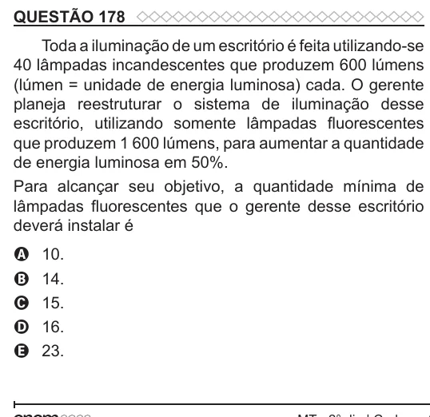

Texto extraído (pode conter ruído)

QUESTÃO 178  
Toda a iluminação de um escritório é feita utilizando-se  
40 lâmpadas incandescentes que produzem 600 lúmens  
(lúmen = unidade de energia luminosa) cada. O gerente  
planeja reestruturar o sistema de iluminação desse  
escritório, utilizando somente lâmpadas fluorescentes  
que produzem 1 600 lúmens, para aumentar a quantidade  
de energia luminosa em 50%.  
Para alcançar seu objetivo, a quantidade mínima de  
lâmpadas fluorescentes que o gerente desse escritório  
deverá instalar é  
10.  
A  
14.  
B  
15.  
C  
D  
16.  
23.  
E

