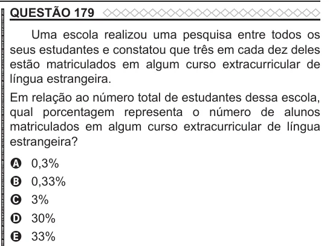

Texto extraído (pode conter ruído)

QUESTÃO 179  
Uma escola realizou uma pesquisa entre todos os  
seus estudantes e constatou que três em cada dez deles  
estão matriculados em algum curso extracurricular de  
língua estrangeira.  
Em relação ao número total de estudantes dessa escola,  
qual porcentagem representa o número de alunos  
matriculados em algum curso extracurricular de língua  
estrangeira?  
0,3%  
A  
0,33%  
B  
3%  
C  
30%  
D  
33%  
E

