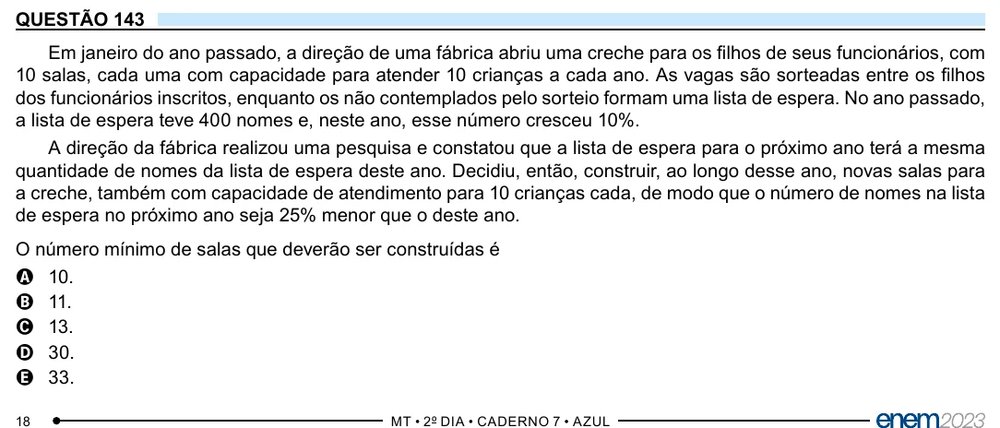

Texto extraído (pode conter ruído)

QUESTÃO 143  
Em janeiro do ano passado, a direção de uma fábrica abriu uma creche para os filhos de seus funcionários, com  
10 salas, cada uma com capacidade para atender 10 crianças a cada ano. As vagas são sorteadas entre os filhos  
dos funcionários inscritos, enquanto os não contemplados pelo sorteio formam uma lista de espera. No ano passado,  
a lista de espera teve 400 nomes e, neste ano, esse número cresceu 10%.  
A direção da fábrica realizou uma pesquisa e constatou que a lista de espera para o próximo ano terá a mesma  
quantidade de nomes da lista de espera deste ano. Decidiu, então, construir, ao longo desse ano, novas salas para  
a creche, também com capacidade de atendimento para 10 crianças cada, de modo que o número de nomes na lista  
de espera no próximo ano seja 25% menor que o deste ano.  
O número mínimo de salas que deverão ser construídas é  
A 10.  
B 11.  
C 13.  
D 30.  
E 33.

