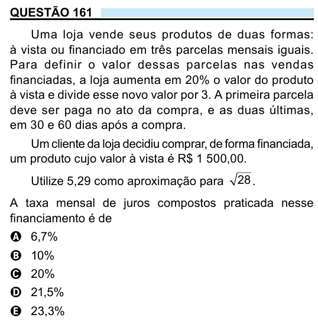

Texto extraído (pode conter ruído)

QUESTÃO 161  
Uma loja vende seus produtos de duas formas:  
à vista ou financiado em três parcelas mensais iguais.  
Para definir o valor dessas parcelas nas vendas  
financiadas, a loja aumenta em 20% o valor do produto  
à vista e divide esse novo valor por 3. A primeira parcela  
deve ser paga no ato da compra, e as duas últimas,  
em 30 e 60 dias após a compra.  
Um cliente da loja decidiu comprar, de forma financiada,  
um produto cujo valor à vista é R$ 1 500,00.  
Utilize 5,29 como aproximação para  
28 .  
A taxa mensal de juros compostos praticada nesse  
financiamento é de  
A 6,7%  
B 10%  
C 20%  
D 21,5%  
E 23,3%

