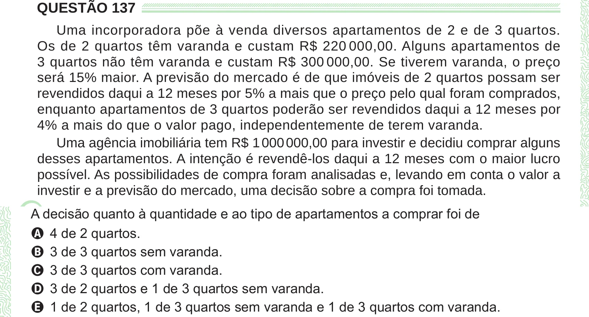

Texto extraído (pode conter ruído)

QUESTÃO 137  
Uma incorporadora põe à venda diversos apartamentos de 2 e de 3 quartos.  
Os de 2 quartos têm varanda e custam R$ 220 000,00. Alguns apartamentos de  
3 quartos não têm varanda e custam R$ 300 000,00. Se tiverem varanda, o preço  
será 15% maior. A previsão do mercado é de que imóveis de 2 quartos possam ser  
revendidos daqui a 12 meses por 5% a mais que o preço pelo qual foram comprados,  
enquanto apartamentos de 3 quartos poderão ser revendidos daqui a 12 meses por  
4% a mais do que o valor pago, independentemente de terem varanda.  
Uma agência imobiliária tem R$ 1 000 000,00 para investir e decidiu comprar alguns  
desses apartamentos. A intenção é revendê-los daqui a 12 meses com o maior lucro  
possível. As possibilidades de compra foram analisadas e, levando em conta o valor a  
investir e a previsão do mercado, uma decisão sobre a compra foi tomada.  
A 4 de 2 quartos.  
B 3 de 3 quartos sem varanda.  
C 3 de 3 quartos com varanda.  
D 3 de 2 quartos e 1 de 3 quartos sem varanda.  
E 1 de 2 quartos, 1 de 3 quartos sem varanda e 1 de 3 quartos com varanda.

