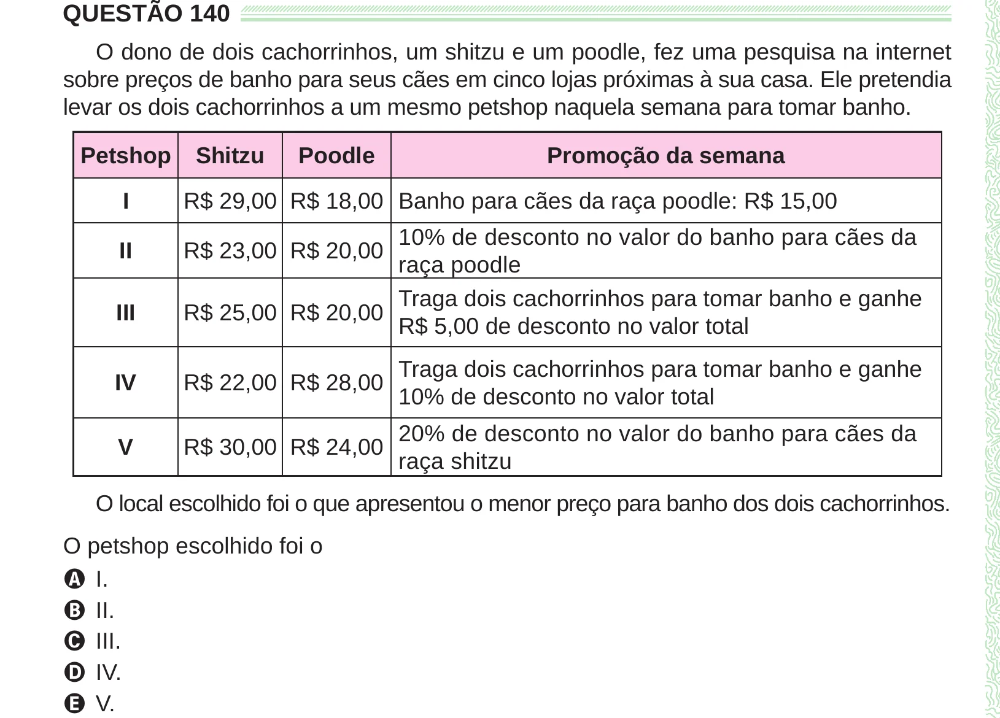

Texto extraído (pode conter ruído)

QUESTÃO 140  
O dono de dois cachorrinhos, um shitzu e um poodle, fez uma pesquisa na internet  
sobre preços de banho para seus cães em cinco lojas próximas à sua casa. Ele pretendia  
levar os dois cachorrinhos a um mesmo petshop naquela semana para tomar banho.  
Petshop  
Shitzu  
Poodle  
Promoção da semana  
I  
R$ 29,00 R$ 18,00 Banho para cães da raça poodle: R$ 15,00  
10% de desconto no valor do banho para cães da  
II  
R$ 23,00 R$ 20,00  
raça poodle  
Traga dois cachorrinhos para tomar banho e ganhe  
III  
R$ 25,00 R$ 20,00  
R$ 5,00 de desconto no valor total  
Traga dois cachorrinhos para tomar banho e ganhe  
IV  
R$ 22,00 R$ 28,00  
10% de desconto no valor total  
20% de desconto no valor do banho para cães da  
V  
R$ 30,00 R$ 24,00  
raça shitzu  
O local escolhido foi o que apresentou o menor preço para banho dos dois cachorrinhos.  
O petshop escolhido foi o  
A I.  
B II.  
C III.  
D IV.  
E V.

