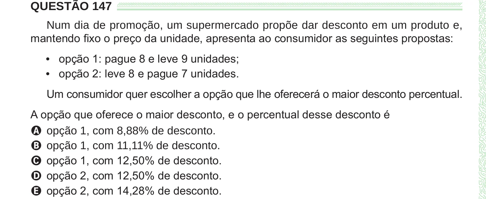

Texto extraído (pode conter ruído)

QUESTÃO 147  
Num dia de promoção, um supermercado propõe dar desconto em um produto e,  
mantendo fixo o preço da unidade, apresenta ao consumidor as seguintes propostas:  
• opção 1: pague 8 e leve 9 unidades;  
• opção 2: leve 8 e pague 7 unidades.  
Um consumidor quer escolher a opção que lhe oferecerá o maior desconto percentual.  
A opção que oferece o maior desconto, e o percentual desse desconto é  
A opção 1, com 8,88% de desconto.  
B opção 1, com 11,11% de desconto.  
C opção 1, com 12,50% de desconto.  
D opção 2, com 12,50% de desconto.  
E opção 2, com 14,28% de desconto.

