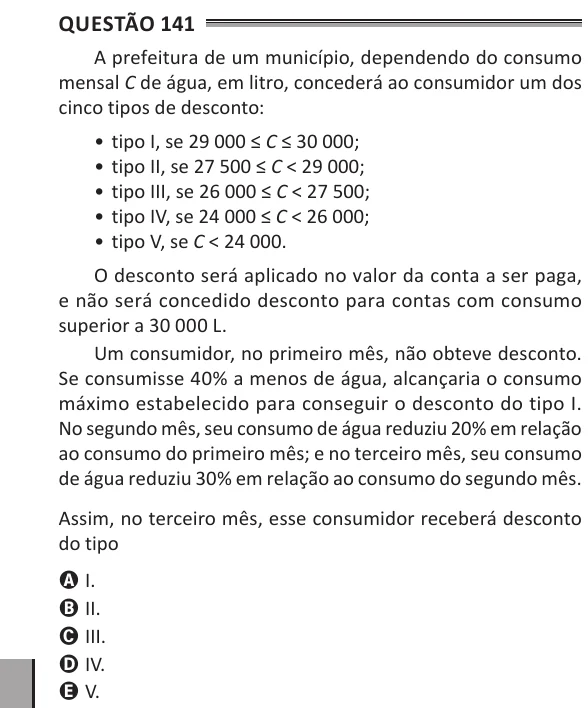

Texto extraído (pode conter ruído)

Questão 141  
A prefeitura de um município, dependendo do consumo  
mensal C de água, em litro, concederá ao consumidor um dos  
cinco tipos de desconto:  
• tipo I, se 29 000 ≤ C ≤ 30 000;  
• tipo II, se 27 500 ≤ C < 29 000;  
• tipo III, se 26 000 ≤ C < 27 500;  
• tipo IV, se 24 000 ≤ C < 26 000;  
• tipo V, se C < 24 000.  
O desconto será aplicado no valor da conta a ser paga,  
e não será concedido desconto para contas com consumo  
superior a 30 000 L.  
Um consumidor, no primeiro mês, não obteve desconto.  
Se consumisse 40% a menos de água, alcançaria o consumo  
máximo estabelecido para conseguir o desconto do tipo I.  
No segundo mês, seu consumo de água reduziu 20% em relação  
ao consumo do primeiro mês; e no terceiro mês, seu consumo  
de água reduziu 30% em relação ao consumo do segundo mês.  
Assim, no terceiro mês, esse consumidor receberá desconto  
do tipo  
A I.  
B II.  
C III.  
D IV.  
E V.

