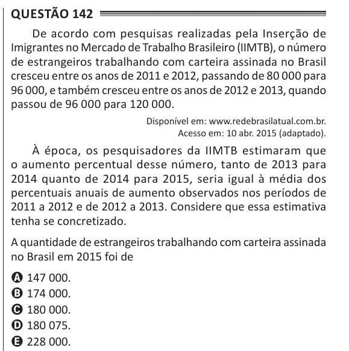

Texto extraído (pode conter ruído)

Questão 142  
De acordo com pesquisas realizadas pela Inserção de  
Imigrantes no Mercado de Trabalho Brasileiro (IIMTB), o número  
de estrangeiros trabalhando com carteira assinada no Brasil  
cresceu entre os anos de 2011 e 2012, passando de 80 000 para  
96 000, e também cresceu entre os anos de 2012 e 2013, quando  
passou de 96 000 para 120 000.  
Disponível em: www.redebrasilatual.com.br.  
Acesso em: 10 abr. 2015 (adaptado).  
À época, os pesquisadores da IIMTB estimaram que  
o aumento percentual desse número, tanto de 2013 para  
2014 quanto de 2014 para 2015, seria igual à média dos  
percentuais anuais de aumento observados nos períodos de  
2011 a 2012 e de 2012 a 2013. Considere que essa estimativa  
tenha se concretizado.  
A quantidade de estrangeiros trabalhando com carteira assinada  
no Brasil em 2015 foi de  
A 147 000.  
B 174 000.  
C 180 000.  
D 180 075.  
E 228 000.

