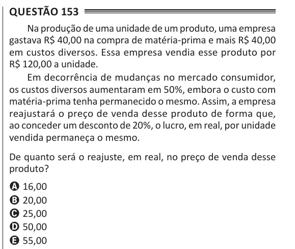

Texto extraído (pode conter ruído)

Questão 153  
Na produção de uma unidade de um produto, uma empresa  
gastava R$ 40,00 na compra de matéria-prima e mais R$ 40,00  
em custos diversos. Essa empresa vendia esse produto por  
R$ 120,00 a unidade.  
Em decorrência de mudanças no mercado consumidor,  
os custos diversos aumentaram em 50%, embora o custo com  
matéria-prima tenha permanecido o mesmo. Assim, a empresa  
reajustará o preço de venda desse produto de forma que,  
ao conceder um desconto de 20%, o lucro, em real, por unidade  
vendida permaneça o mesmo.  
De quanto será o reajuste, em real, no preço de venda desse  
produto?  
A 16,00  
B 20,00  
C 25,00  
D 50,00  
E 55,00

