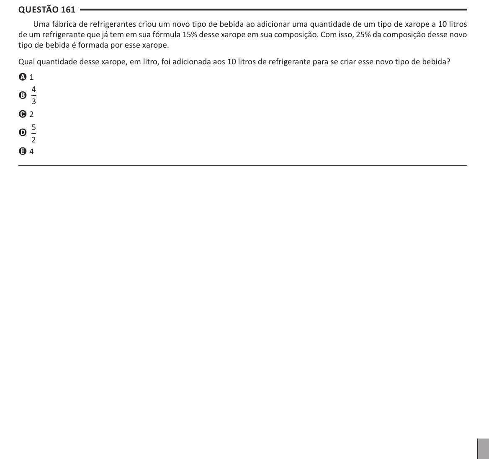

Texto extraído (pode conter ruído)

Questão 161  
Uma fábrica de refrigerantes criou um novo tipo de bebida ao adicionar uma quantidade de um tipo de xarope a 10 litros  
de um refrigerante que já tem em sua fórmula 15% desse xarope em sua composição. Com isso, 25% da composição desse novo  
tipo de bebida é formada por esse xarope.  
Qual quantidade desse xarope, em litro, foi adicionada aos 10 litros de refrigerante para se criar esse novo tipo de bebida?  
A 1  
4  
B  
3  
C 2  
5  
D  
2  
E 4

