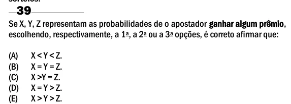

Texto extraído (pode conter ruído)

39  
Se X, Y, Z representam as probabilidades de o apostador ganhar algum prêmio,  
escolhendo, respectivamente, a 1 a , a 2 a ou a 3 a opções, é correto afirmar que:  
(A)  
X < Y < Z.  
(B)  
X = Y = Z.  
(C)  
X >Y = Z.  
(D)  
X = Y > Z.  
(E)  
X > Y > Z.

