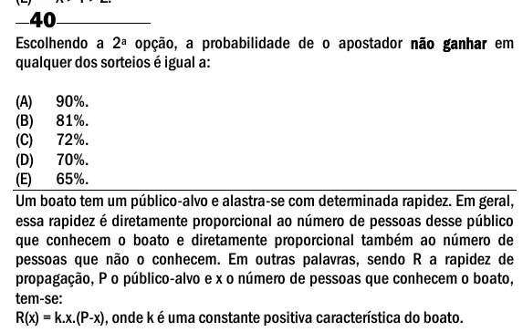

Texto extraído (pode conter ruído)

40  
Escolhendo a 2 a opção, a probabilidade de o apostador não ganhar em  
qualquer dos sorteios é igual a:  
(A) 90%.  
(B) 81%.  
(C) 72%.  
(D) 70%.  
(E) 65%.  
Um boato tem um público-alvo e alastra-se com determinada rapidez. Em geral,  
essa rapidez é diretamente proporcional ao número de pessoas desse público  
que conhecem o boato e diretamente proporcional também ao número de  
pessoas que não o conhecem. Em outras palavras, sendo R a rapidez de  
propagação, P o público-alvo e x o número de pessoas que conhecem o boato,  
tem-se:  
R(x) = k.x.(P-x), onde k é uma constante positiva característica do boato.

