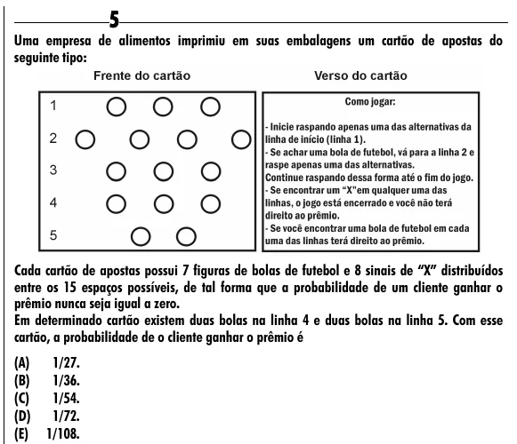

Texto extraído (pode conter ruído)

5  
Uma empresa de alimentos imprimiu em suas embalagens um cartão de apostas do  
seguinte tipo:  
Cada cartão de apostas possui 7 figuras de bolas de futebol e 8 sinais de “X” distribuídos  
entre os 15 espaços possíveis, de tal forma que a probabilidade de um cliente ganhar o  
prêmio nunca seja igual a zero.  
Em determinado cartão existem duas bolas na linha 4 e duas bolas na linha 5. Com esse  
cartão, a probabilidade de o cliente ganhar o prêmio é  
(A)  
1/27.  
(B)  
1/36.  
(C)  
1/54.  
(D)  
1/72.  
(E)  
1/108.

