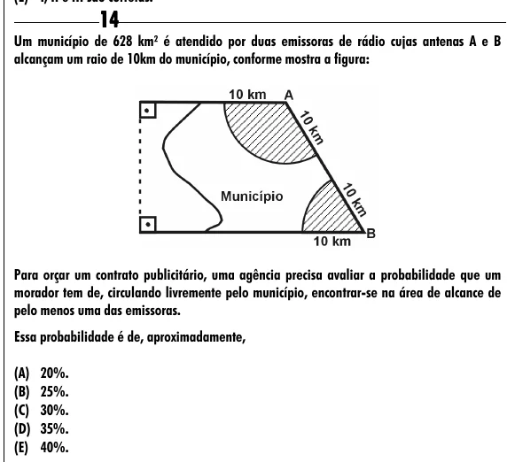

Texto extraído (pode conter ruído)

14  
Um município de 628 km² é atendido por duas emissoras de rádio cujas antenas A e B  
alcançam um raio de 10km do município, conforme mostra a figura:  
Para orçar um contrato publicitário, uma agência precisa avaliar a probabilidade que um  
morador tem de, circulando livremente pelo município, encontrar-se na área de alcance de  
pelo menos uma das emissoras.  
Essa probabilidade é de, aproximadamente,  
(A) 20%.  
(B) 25%.  
(C) 30%.  
(D) 35%.  
(E) 40%.

