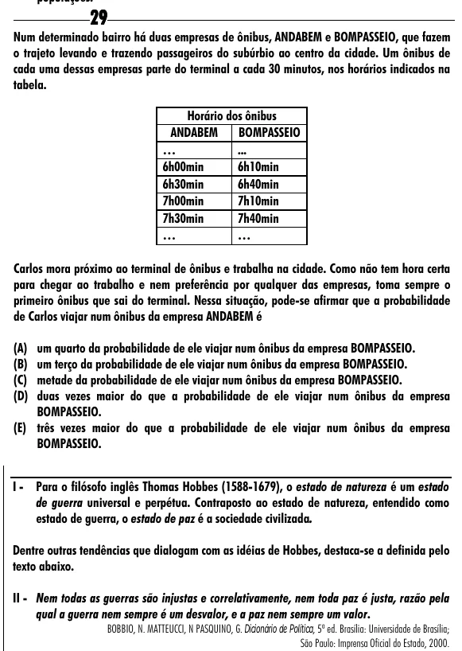

Texto extraído (pode conter ruído)

29  
Num determinado bairro há duas empresas de ônibus, ANDABEM e BOMPASSEIO, que fazem  
o trajeto levando e trazendo passageiros do subúrbio ao centro da cidade. Um ônibus de  
cada uma dessas empresas parte do terminal a cada 30 minutos, nos horários indicados na  
tabela.  
Horário dos ônibus  
ANDABEM  
BOMPASSEIO  
…  
...  
6h00min  
6h10min  
6h30min  
6h40min  
7h00min  
7h10min  
7h30min  
7h40min  
…  
…  
Carlos mora próximo ao terminal de ônibus e trabalha na cidade. Como não tem hora certa  
para chegar ao trabalho e nem preferência por qualquer das empresas, toma sempre o  
primeiro ônibus que sai do terminal. Nessa situação, pode-se afirmar que a probabilidade  
de Carlos viajar num ônibus da empresa ANDABEM é  
(A) um quarto da probabilidade de ele viajar num ônibus da empresa BOMPASSEIO.  
(B) um terço da probabilidade de ele viajar num ônibus da empresa BOMPASSEIO.  
(C) metade da probabilidade de ele viajar num ônibus da empresa BOMPASSEIO.  
(D) duas vezes maior do que a probabilidade de ele viajar num ônibus da empresa  
BOMPASSEIO.  
(E) três vezes maior do que a probabilidade de ele viajar num ônibus da empresa  
BOMPASSEIO.  
I - Para o filósofo inglês Thomas Hobbes (1588-1679), o estado de natureza é um estado  
de guerra universal e perpétua. Contraposto ao estado de natureza, entendido como  
estado de guerra, o estado de paz é a sociedade civilizada.  
Dentre outras tendências que dialogam com as idéias de Hobbes, destaca-se a definida pelo  
texto abaixo.  
II - Nem todas as guerras são injustas e correlativamente, nem toda paz é justa, razão pela  
qual a guerra nem sempre é um desvalor, e a paz nem sempre um valor.  
BOBBIO, N. MATTEUCCI, N PASQUINO, G. Dicionário de Política, 5ª ed. Brasília: Universidade de Brasília;  
São Paulo: Imprensa Oficial do Estado, 2000.

