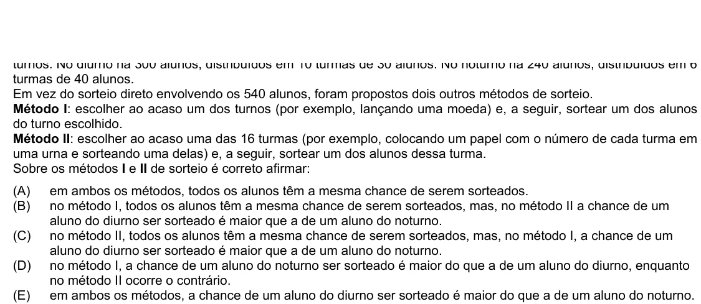

Texto extraído (pode conter ruído)

turmas de 40 alunos.  
Em vez do sorteio direto envolvendo os 540 alunos, foram propostos dois outros métodos de sorteio.  
Método I: escolher ao acaso um dos turnos (por exemplo, lançando uma moeda) e, a seguir, sortear um dos alunos  
do turno escolhido.  
Método II: escolher ao acaso uma das 16 turmas (por exemplo, colocando um papel com o número de cada turma em  
uma urna e sorteando uma delas) e, a seguir, sortear um dos alunos dessa turma.  
Sobre os métodos I e II de sorteio é correto afirmar:  
(A)  
em ambos os métodos, todos os alunos têm a mesma chance de serem sorteados.  
(B)  
no método I, todos os alunos têm a mesma chance de serem sorteados, mas, no método II a chance de um  
aluno do diurno ser sorteado é maior que a de um aluno do noturno.  
(C)  
no método II, todos os alunos têm a mesma chance de serem sorteados, mas, no método I, a chance de um  
aluno do diurno ser sorteado é maior que a de um aluno do noturno.  
(D)  
no método I, a chance de um aluno do noturno ser sorteado é maior do que a de um aluno do diurno, enquanto  
no método II ocorre o contrário.  
(E)  
em ambos os métodos, a chance de um aluno do diurno ser sorteado é maior do que a de um aluno do noturno.

