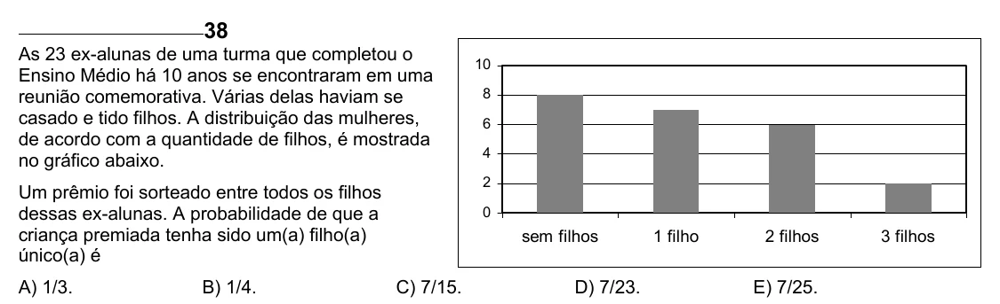

Texto extraído (pode conter ruído)

38  
As 23 ex-alunas de uma turma que completou o  
10  
Ensino Médio há 10 anos se encontraram em uma  
reunião comemorativa. Várias delas haviam se  
8  
casado e tido filhos. A distribuição das mulheres,  
6  
de acordo com a quantidade de filhos, é mostrada  
4  
no gráfico abaixo.  
2  
Um prêmio foi sorteado entre todos os filhos  
dessas ex-alunas. A probabilidade de que a  
0  
criança premiada tenha sido um(a) filho(a)  
sem filhos  
1 filho  
2 filhos  
3 filhos  
único(a) é  
A) 1/3.  
B) 1/4.  
C) 7/15.  
D) 7/23.  
E) 7/25.

