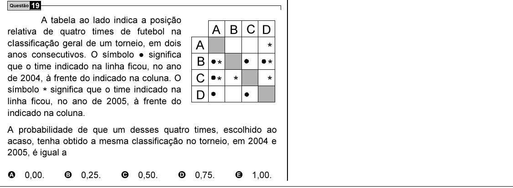

Texto extraído (pode conter ruído)

Questão 19  
A tabela ao lado indica a posição  
A B C D  
relativa de quatro times de futebol na  
A  
cIassificação geral de um torneio, em dois  
*  
anos consecutivos. O símbolo ● significa  
B *  
*  
que o time indicado na linha ficou, no ano  
C * *  
*  
de 2004, à frente do indicado na coluna. O  
símbolo * significa que o time indicado na  
D  
linha ficou, no ano de 2005, à frente do  
indicado na coluna.  
A probabilidade de que um desses quatro times, escolhido ao  
acaso, tenha obtido a mesma classificação no torneio, em 2004 e  
2005, é igual a  
A 0,00.  
B 0,25.  
C 0,50.  
D 0,75.  
E 1,00.

