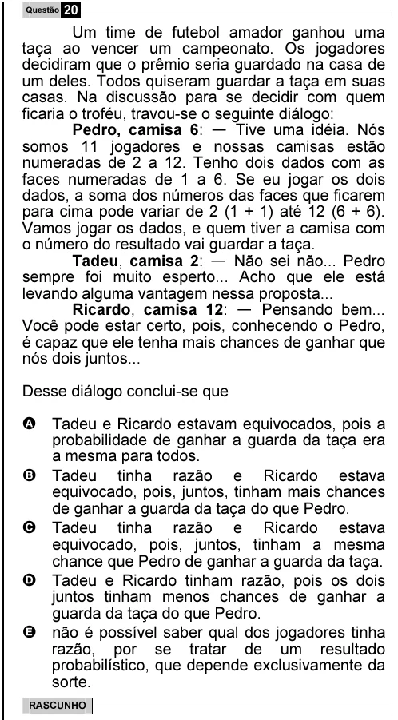

Texto extraído (pode conter ruído)

Questão 20  
Um time de futebol amador ganhou uma  
taça ao vencer um campeonato. Os jogadores  
decidiram que o prêmio seria guardado na casa de  
um deles. Todos quiseram guardar a taça em suas  
casas. Na discussão para se decidir com quem  
ficaria o troféu, travou-se o seguinte diálogo:  
Pedro, camisa 6: — Tive uma idéia. Nós  
somos 11 jogadores e nossas camisas estão  
numeradas de 2 a 12. Tenho dois dados com as  
faces numeradas de 1 a 6. Se eu jogar os dois  
dados, a soma dos números das faces que ficarem  
para cima pode variar de 2 (1 + 1) até 12 (6 + 6).  
Vamos jogar os dados, e quem tiver a camisa com  
o número do resultado vai guardar a taça.  
Tadeu, camisa 2: — Não sei não... Pedro  
sempre foi muito esperto... Acho que ele está  
levando alguma vantagem nessa proposta...  
Ricardo, camisa 12: — Pensando bem...  
Você pode estar certo, pois, conhecendo o Pedro,  
é capaz que ele tenha mais chances de ganhar que  
nós dois juntos...  
Desse diálogo conclui-se que  
A Tadeu e Ricardo estavam equivocados, pois a  
probabilidade de ganhar a guarda da taça era  
a mesma para todos.  
B Tadeu tinha razão e Ricardo estava  
equivocado, pois, juntos, tinham mais chances  
de ganhar a guarda da taça do que Pedro.  
C Tadeu tinha razão e Ricardo estava  
equivocado, pois, juntos, tinham a mesma  
chance que Pedro de ganhar a guarda da taça.  
D Tadeu e Ricardo tinham razão, pois os dois  
juntos tinham menos chances de ganhar a  
guarda da taça do que Pedro.  
E não é possível saber qual dos jogadores tinha  
razão, por se tratar de um resultado  
probabilístico, que depende exclusivamente da  
sorte.  
RASCUNHO

