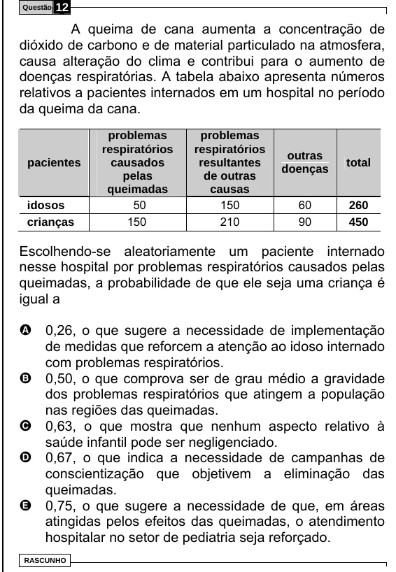

Texto extraído (pode conter ruído)

Questão  
12  
A queima de cana aumenta a concentração de  
dióxido de carbono e de material particulado na atmosfera,  
causa alteração do clima e contribui para o aumento de  
doenças respiratórias. A tabela abaixo apresenta números  
relativos a pacientes internados em um hospital no período  
da queima da cana.  
problemas  
problemas  
respiratórios  
respiratórios  
outras  
pacientes  
causados  
resultantes  
total  
doenças  
pelas  
de outras  
queimadas  
causas  
50  
150  
60  
idosos  
260  
150  
210  
90  
crianças  
450  
Escolhendo-se aleatoriamente um paciente internado  
nesse hospital por problemas respiratórios causados pelas  
queimadas, a probabilidade de que ele seja uma criança é  
igual a  
A 0,26, o que sugere a necessidade de implementação  
de medidas que reforcem a atenção ao idoso internado  
com problemas respiratórios.  
B  
0,50, o que comprova ser de grau médio a gravidade  
dos problemas respiratórios que atingem a população  
nas regiões das queimadas.  
C  
0,63, o que mostra que nenhum aspecto relativo à  
saúde infantil pode ser negligenciado.  
0,67, o que indica a necessidade de campanhas de  
D  
conscientização que objetivem a eliminação das  
queimadas.  
E  
0,75, o que sugere a necessidade de que, em áreas  
atingidas pelos efeitos das queimadas, o atendimento  
hospitalar no setor de pediatria seja reforçado.  
RASCUNHO

