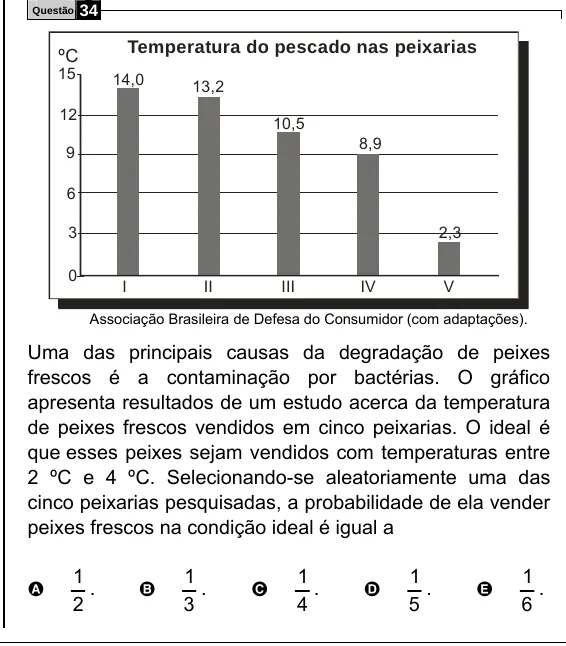

Texto extraído (pode conter ruído)

34  
Questão  
Temperatura do pescado nas peixarias  
ºC  
15  
14,0  
13,2  
12  
10,5  
8,9  
9  
6  
3  
2,3  
0  
I  
II  
III  
IV  
V  
Associação Brasileira de Defesa do Consumidor (com adaptações).  
Uma das principais causas da degradação de peixes  
frescos é a contaminação por bactérias. O gráfico  
apresenta resultados de um estudo acerca da temperatura  
de peixes frescos vendidos em cinco peixarias. O ideal é  
que esses peixes sejam vendidos com temperaturas entre  
2 ºC e 4 ºC. Selecionando-se aleatoriamente uma das  
cinco peixarias pesquisadas, a probabilidade de ela vender  
peixes frescos na condição ideal é igual a  
1  
1  
1  
1  
1  
.  
.  
.  
.  
.  
A  
B  
C  
D  
E  
2  
3  
4  
5  
6

