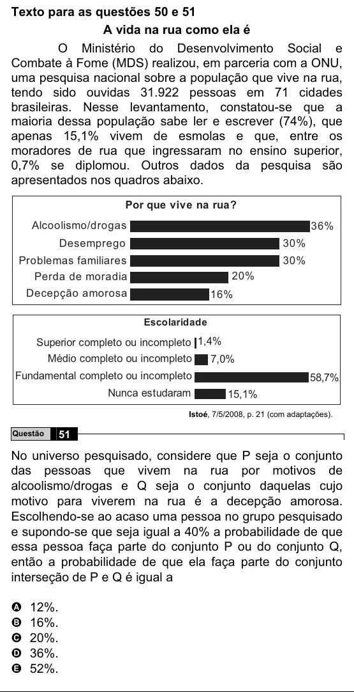

Texto extraído (pode conter ruído)

Texto para as questões 50 e 51  
A vida na rua como ela é  
O Ministério do Desenvolvimento Social e  
Combate à Fome (MDS) realizou, em parceria com a ONU,  
uma pesquisa nacional sobre a população que vive na rua,  
tendo sido ouvidas 31.922 pessoas em 71 cidades  
brasileiras. Nesse levantamento, constatou-se que a  
maioria dessa população sabe ler e escrever (74%), que  
apenas 15,1% vivem de esmolas e que, entre os  
moradores de rua que ingressaram no ensino superior,  
0,7% se diplomou. Outros dados da pesquisa são  
apresentados nos quadros abaixo.  
Por que vive na rua?  
Alcoolismo/drogas  
36%  
Desemprego  
30%  
Problemas familiares  
30%  
Perda de moradia  
20%  
Decepção amorosa  
16%  
Escolaridade  
Superior completo ou incompleto 1,4%  
Médio completo ou incompleto  
7,0%  
Fundamental completo ou incompleto  
58,7%  
Nunca estudaram  
15,1%  
Istoé, 7/5/2008, p. 21 (com adaptações).  
51  
Questão  
No universo pesquisado, considere que P seja o conjunto  
das pessoas que vivem na rua por motivos de  
alcoolismo/drogas e Q seja o conjunto daquelas cujo  
motivo para viverem na rua é a decepção amorosa.  
Escolhendo-se ao acaso uma pessoa no grupo pesquisado  
e supondo-se que seja igual a 40% a probabilidade de que  
essa pessoa faça parte do conjunto P ou do conjunto Q,  
então a probabilidade de que ela faça parte do conjunto  
interseção de P e Q é igual a  
A 12%.  
B 16%.  
C 20%.  
D 36%.  
E 52%.

