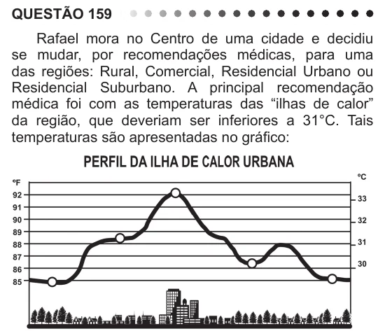

Texto extraído (pode conter ruído)

QUESTÃO 159  
Rafael mora no Centro de uma cidade e decidiu  
se mudar, por recomendações médicas, para uma  
das regiões: Rural, Comercial, Residencial Urbano ou  
Residencial Suburbano. A principal recomendação  
médica foi com as temperaturas das “ilhas de calor”  
da região, que deveriam ser inferiores a 31°C. Tais  
temperaturas são apresentadas no gráfico:  
Escolhendo, aleatoriamente, uma das outras regiões  
para morar, a probabilidade de ele escolher uma região  
que seja adequada às recomendações médicas é  
A 1  
5  
B 1  
4  
C 2  
5  
D 3  
5  
E 3  
4

