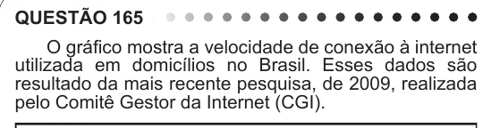

Texto extraído (pode conter ruído)

QUESTÃO 165  
O gráfico mostra a velocidade de conexão à internet  
utilizada em domicílios no Brasil. Esses dados são  
resultado da mais recente pesquisa, de 2009, realizada  
pelo Comitê Gestor da Internet (CGI).  
Disponível em: http://agencia.ipea.gov.br. Acesso em: 28 abr. 2010 (adaptado).  
Escolhendo-se, aleatoriamente, um domicílio pesquisado,  
qual a chance de haver banda larga de conexão de pelo  
menos 1 Mbps neste domicílio?  
A 0,45  
B 0,42  
C 0,30  
D 0,22  
E 0,15

