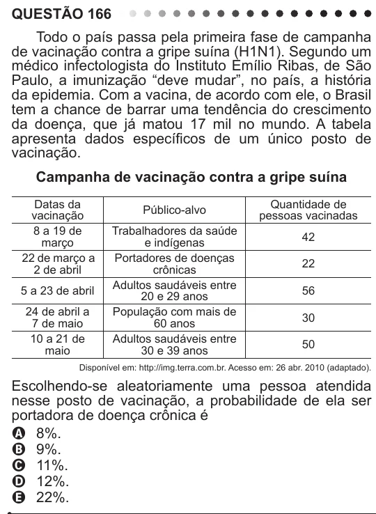

Texto extraído (pode conter ruído)

QUESTÃO 166  
Todo o país passa pela primeira fase de campanha  
de vacinação contra a gripe suína (H1N1). Segundo um  
médico infectologista do Instituto Emílio Ribas, de São  
Paulo, a imunização “deve mudar”, no país, a história  
da epidemia. Com a vacina, de acordo com ele, o Brasil  
tem a chance de barrar uma tendência do crescimento  
da doença, que já matou 17 mil no mundo. A tabela  
apresenta dados específicos de um único posto de  
vacinação.  
Campanha de vacinação contra a gripe suína  
Datas da  
Quantidade de  
Público-alvo  
vacinação  
pessoas vacinadas  
8 a 19 de  
Trabalhadores da saúde  
42  
março  
e indígenas  
22 de março a  
Portadores de doenças  
22  
2 de abril  
crônicas  
Adultos saudáveis entre  
5 a 23 de abril  
56  
20 e 29 anos  
24 de abril a  
População com mais de  
30  
7 de maio  
60 anos  
10 a 21 de  
Adultos saudáveis entre  
50  
maio  
30 e 39 anos  
Disponível em: http://img.terra.com.br. Acesso em: 26 abr. 2010 (adaptado).  
Escolhendo-se aleatoriamente uma pessoa atendida  
nesse posto de vacinação, a probabilidade de ela ser  
portadora de doença crônica é  
A 8%.  
B 9%.  
C 11%.  
D 12%.  
E 22%.

