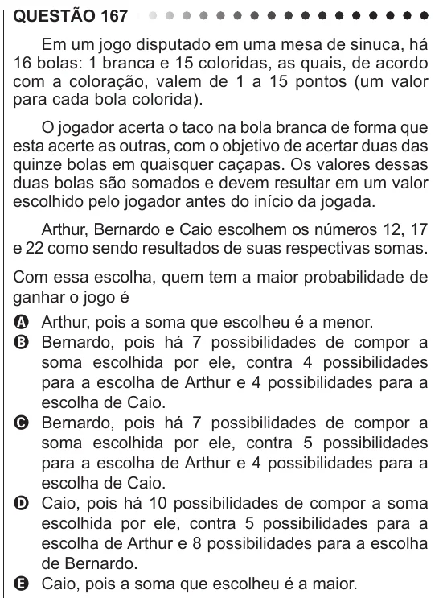

Texto extraído (pode conter ruído)

QUESTÃO 167  
Em um jogo disputado em uma mesa de sinuca, há  
16 bolas: 1 branca e 15 coloridas, as quais, de acordo  
com a coloração, valem de 1 a 15 pontos (um valor  
para cada bola colorida).  
O jogador acerta o taco na bola branca de forma que  
esta acerte as outras, com o objetivo de acertar duas das  
quinze bolas em quaisquer caçapas. Os valores dessas  
duas bolas são somados e devem resultar em um valor  
escolhido pelo jogador antes do início da jogada.  
Arthur, Bernardo e Caio escolhem os números 12, 17  
e 22 como sendo resultados de suas respectivas somas.  
Com essa escolha, quem tem a maior probabilidade de  
ganhar o jogo é  
A Arthur, pois a soma que escolheu é a menor.  
B Bernardo, pois há 7 possibilidades de compor a  
soma escolhida por ele, contra 4 possibilidades  
para a escolha de Arthur e 4 possibilidades para a  
escolha de Caio.  
C Bernardo, pois há 7 possibilidades de compor a  
soma escolhida por ele, contra 5 possibilidades  
para a escolha de Arthur e 4 possibilidades para a  
escolha de Caio.  
D Caio, pois há 10 possibilidades de compor a soma  
escolhida por ele, contra 5 possibilidades para a  
escolha de Arthur e 8 possibilidades para a escolha  
de Bernardo.  
E Caio, pois a soma que escolheu é a maior.

