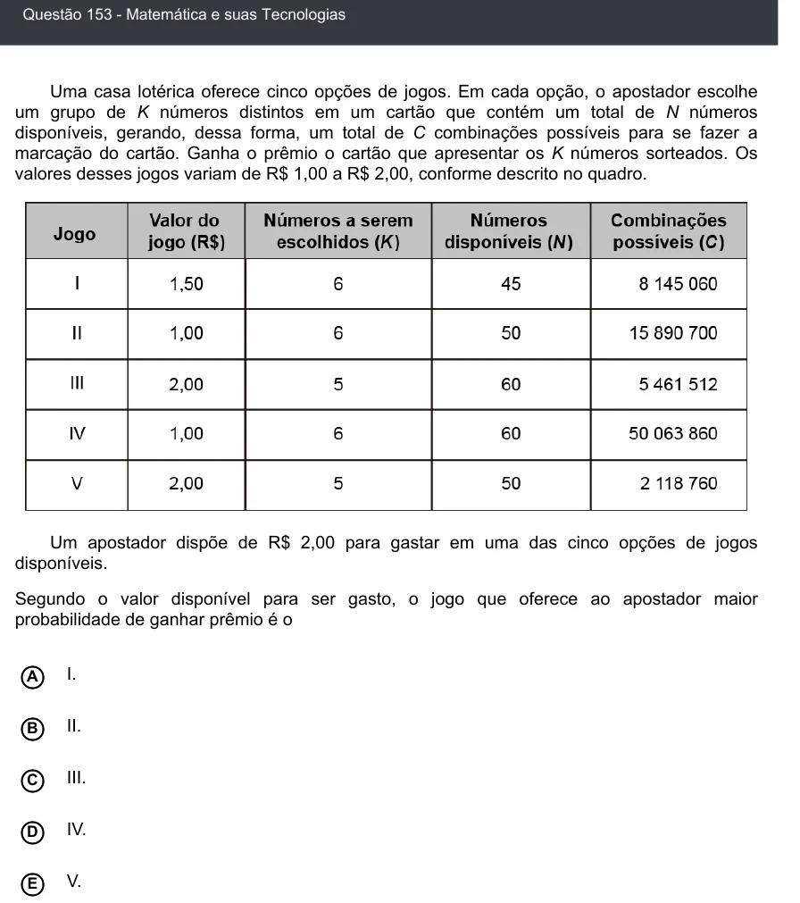

Texto extraído (pode conter ruído)

Questão 153 - Matemática e suas Tecnologias  
Uma casa lotérica oferece cinco opções de jogos. Em cada opção, o apostador escolhe  
um grupo de K números distintos em um cartão que contém um total de N números  
disponíveis, gerando, dessa forma, um total de C combinações possíveis para se fazer a  
marcação do cartão. Ganha o prêmio o cartão que apresentar os K números sorteados. Os  
valores desses jogos variam de R$ 1,00 a R$ 2,00, conforme descrito no quadro.  
Um apostador dispõe de R$ 2,00 para gastar em uma das cinco opções de jogos  
disponíveis.  
Segundo o valor disponível para ser gasto, o jogo que oferece ao apostador maior  
probabilidade de ganhar prêmio é o  
I.  
A  
II.  
B  
C  
III.  
IV.  
D  
V.  
E

