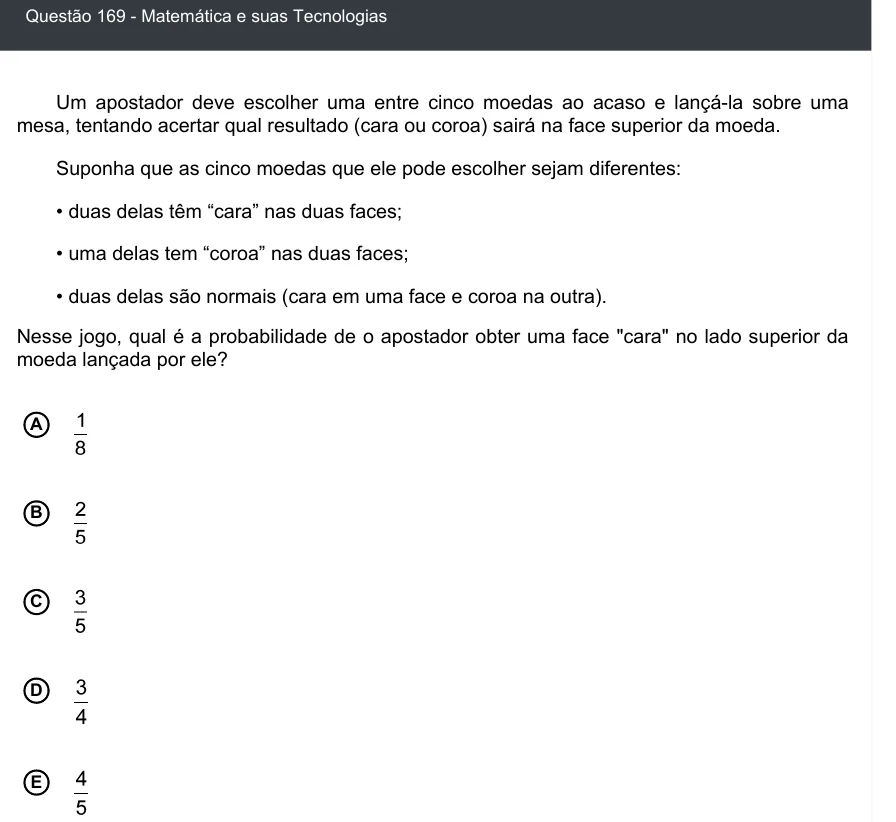

Texto extraído (pode conter ruído)

Questão 169 - Matemática e suas Tecnologias  
Um apostador deve escolher uma entre cinco moedas ao acaso e lançá-la sobre uma  
mesa, tentando acertar qual resultado (cara ou coroa) sairá na face superior da moeda.  
Suponha que as cinco moedas que ele pode escolher sejam diferentes:  
• duas delas têm “cara” nas duas faces;  
• uma delas tem “coroa” nas duas faces;  
• duas delas são normais (cara em uma face e coroa na outra).  
Nesse jogo, qual é a probabilidade de o apostador obter uma face "cara" no lado superior da  
moeda lançada por ele?  
A  
B  
C  
D  
E

